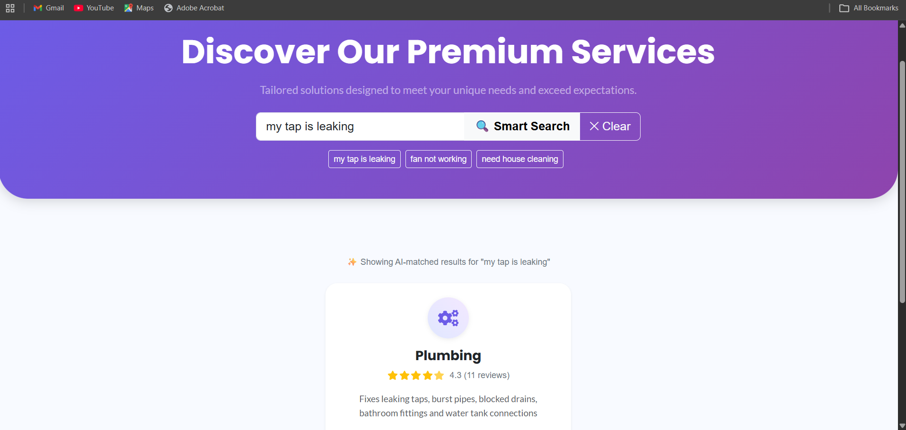
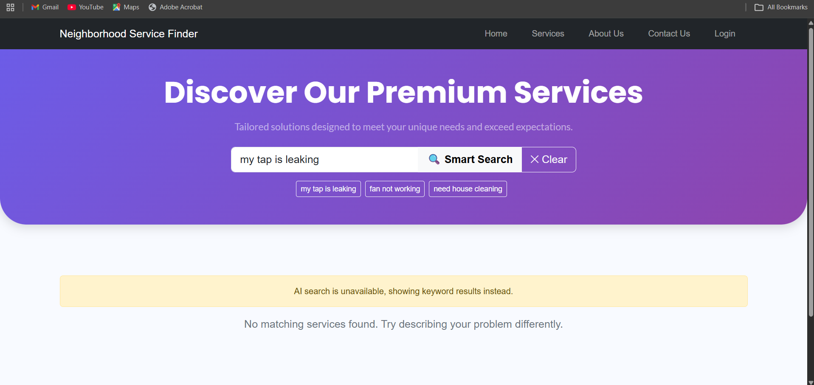
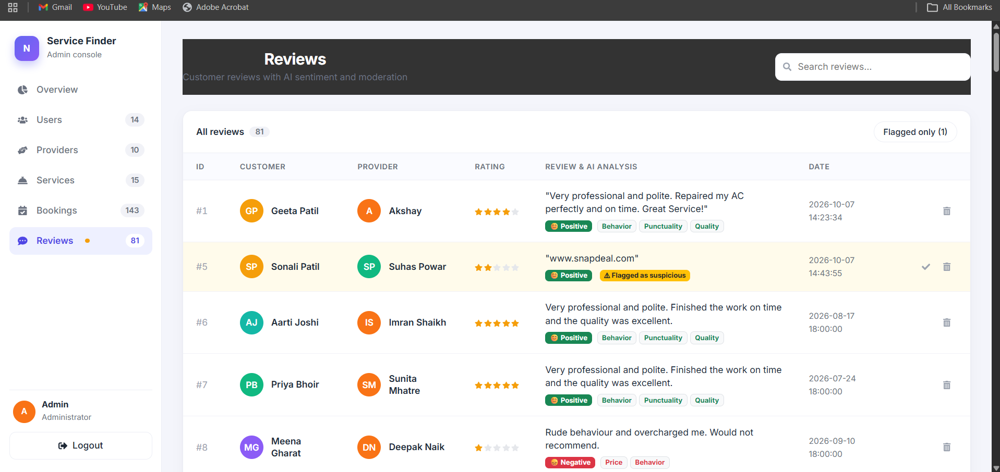
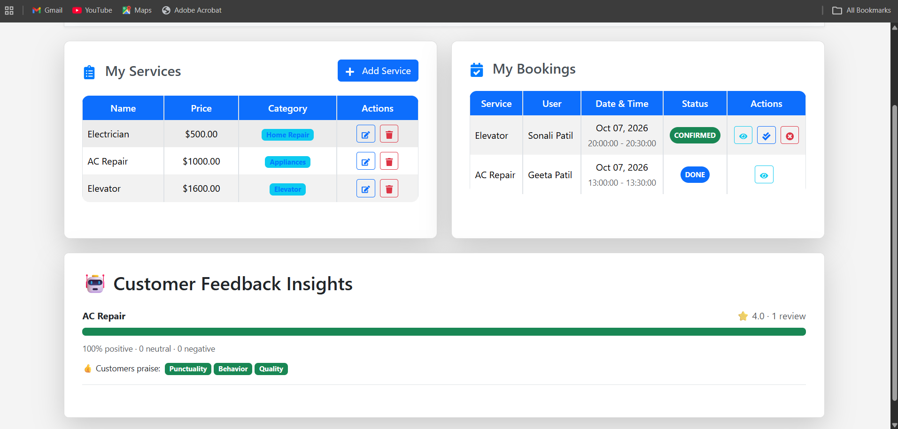
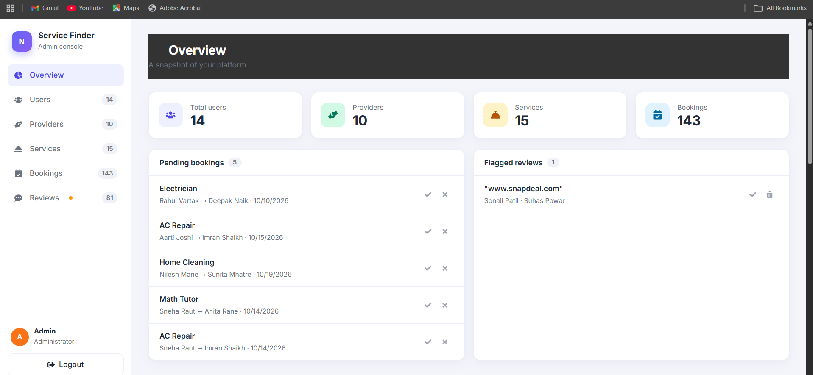
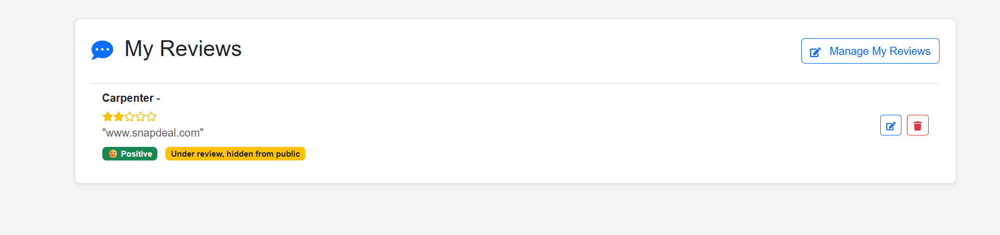
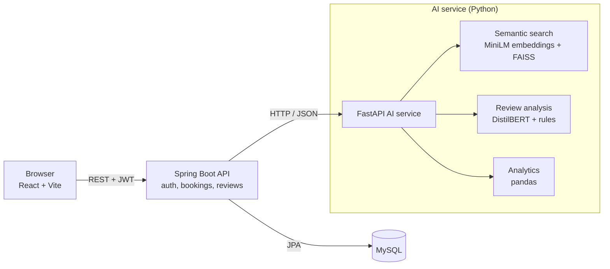
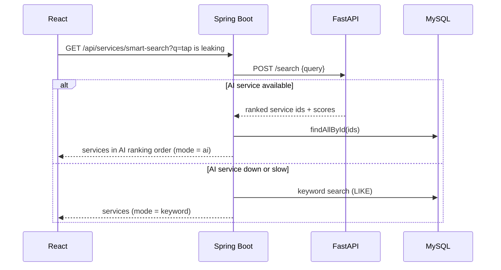

# 🏙️ Neighborhood Service Finder

[](https://github.com/Nikita-Patil5/Neighborhood-Service-Finder/actions)

A full-stack marketplace that connects customers with nearby service providers (electricians, plumbers, cleaners and more).
It combines a **Spring Boot** REST API, a **React** frontend and a separate **Python AI microservice** that powers
semantic search, review sentiment analysis, spam detection and an analytics dashboard with demand forecasting.

<p align="center">
  
</p>

> Smart search understands a plain-language problem. Here, 'my tap is leaking' returns plumbing services first.

## 📸 Screenshots

| | |
|---|---|
| <br>**Fail-safe search:** if the AI service is down, search falls back to keywords and tells the user | <br>**Review analysis:** sentiment badge plus aspect tags (price, punctuality, quality, behavior) |
| <br>**Provider insights:** what customers praise and what needs improvement | <br>**Admin overview:** pending bookings and flagged reviews that need attention |
| <br>**Analytics:** KPIs, bookings per month with forecast, demand by category, sentiment and status split | <br>**Moderation:** suspected spam is flagged, hidden from the public and decided by an admin |


---

## ✨ Features

### 👤 User
- Register / login (JWT), browse services, **describe a problem in plain language and get matching services** (AI search)
- Book a service with email confirmation, view and cancel bookings
- Review completed bookings (add, edit, delete)

### 👨‍🔧 Provider
- Manage services and bookings, mark jobs as done
- **Customer Feedback Insights**: positive / neutral / negative split per service, and which aspects customers praise or criticize

### 👨‍💼 Admin
- Manage users, providers, services, bookings and reviews
- **Analytics**: bookings per month with forecast, demand by category, status and sentiment breakdown, top providers, cancellation rate
- **AI moderation**: suspicious reviews are flagged and hidden from the public until approved

---

## 🏗️ Architecture



The AI features live in their own service so models can be scaled, restarted and updated independently of the main API.
**The core app never depends on it**: if the AI service is down, search falls back to keyword matching and reviews are still saved.

### Smart search flow



---

## 🤖 How the AI parts work

| Feature | Approach | Why this approach |
|---|---|---|
| **Smart search** | Service name, category and description are embedded with `all-MiniLM-L6-v2`; cosine similarity via an in-memory FAISS index. Spring Boot pushes the services at startup and after every create / update / delete. | Finds "tap leaking" → Plumbing without shared keywords. At this data size an in-memory index is simpler and faster than a vector database. |
| **Review sentiment** | Pretrained DistilBERT (SST-2). Predictions below 0.70 confidence become *neutral*. Sentences mentioning price, punctuality, quality or behavior are classified separately to produce **aspect tags**. | Fast CPU inference, no training data needed. Aspect tags give providers actionable feedback. |
| **Spam flagging** | Rule-based: links, long runs of repeated characters, mostly-uppercase text. | Cheap, explainable and easy to test. A trained classifier is future work. |
| **Analytics + forecast** | Spring Boot sends raw booking and review rows; pandas computes KPIs, monthly series (gaps filled with 0), rankings. Forecast = linear trend over the last ≤ 6 full months; the unfinished current month is excluded. | Transparent and testable. Reports its own confidence (low with < 4 months of data). |

> **Note:** the models are pretrained and *served* by this project, not trained from scratch.
> Fine-tuning on a domain-specific review dataset is listed under future work.

---

## 🛠️ Tech stack

| Layer | Technologies |
|---|---|
| Backend | Java, Spring Boot 3, Spring Security + JWT, Spring Data JPA (Hibernate), MySQL, Lombok |
| Frontend | React, Vite, React Router, Axios, React-Bootstrap, Recharts |
| AI service | Python, FastAPI, sentence-transformers, FAISS, Hugging Face Transformers, pandas, NumPy |
| DevOps | Docker, Docker Compose, GitHub Actions |
| Testing | JUnit 5, Mockito, AssertJ, pytest |

---

## 🚀 Quick start (Docker)

Requires Docker Desktop. The first start downloads the ML models (about 300 MB), so allow a few minutes.

```bash
git clone https://github.com/Nikita-Patil5/Neighborhood-Service-Finder.git
cd Neighborhood-Service-Finder
cp .env.example .env          # set a database password; APP_SEED=true loads demo data
docker compose up --build
```

| Service | URL |
|---|---|
| App | http://localhost:5173 |
| API | http://localhost:8080 |
| AI service docs | http://localhost:8000/docs |

### Demo accounts

With `APP_SEED=true` the app creates 6 providers, 12 customers, 10 services, ~140 bookings across 6 months and ~65 AI-analyzed reviews.
All demo accounts use the password `Test@1234` (**demo only, never reuse it**):
`seed.provider1@nsf.test` … `seed.provider6@nsf.test`, `seed.user1@nsf.test` … `seed.user12@nsf.test`.

> The seeder only runs when `app.seed=true` and skips itself if the demo data already exists.

---

## 💻 Run locally without Docker

```bash
# 1. AI service (Python 3.10 - 3.12 recommended)
cd ai-service
python -m venv venv && source venv/bin/activate      # Windows: venv\Scripts\activate
pip install -r requirements.txt
python -m uvicorn main:app --port 8000

# 2. Backend (start AFTER the AI service so it can build the search index)
cd servicefinder/servicefinder
# set DB credentials and  ai.service.url=http://localhost:8000  in application.properties
mvn spring-boot:run

# 3. Frontend
cd servicefinder/neighborhood-frontend
npm install
npm run dev
```

---

## 🔗 API overview

| Area | Endpoints |
|---|---|
| Auth | `POST /api/auth/register`, `POST /api/auth/login` |
| Services | `GET /api/services`, `GET /api/services/smart-search?q=`, `POST/PUT/DELETE /api/services` |
| Bookings | `POST /api/bookings`, `GET /api/bookings/my`, `PUT /api/bookings/{id}/cancel` |
| Reviews | `POST /api/reviews`, `PUT/DELETE /api/reviews/{id}`, `GET /api/reviews/service/{id}`, `GET /api/reviews/provider/insights` |
| Admin | `GET /api/admin/analytics`, `GET /api/reviews/all`, `PUT /api/reviews/admin/{id}/approve` |
| AI service | `POST /index`, `POST /search`, `POST /review/analyze`, `POST /analytics`, `GET /health` |

Endpoints are protected with JWT and role checks (`USER`, `PROVIDER`, `ADMIN`) through `@PreAuthorize`.

---

## ✅ Testing

```bash
# Backend: JUnit 5 + Mockito
cd servicefinder/servicefinder && mvn test

# AI service: pytest (analytics logic, forecast edge cases)
cd ai-service && pip install pandas numpy pytest && pytest -q
```

What is covered: smart-search ranking order, keyword fallback and stale-index handling; review analysis storage,
spam flag and "AI down" behavior; provider insight aggregation; analytics KPIs, month gap-filling, forecast
(including excluding the unfinished current month), and empty / invalid input. GitHub Actions runs backend, AI-service and frontend checks on every push.

---

## 🧠 Design decisions and trade-offs

- **Separate AI service** instead of embedding models in Java: Python has the ML ecosystem, and the models can scale independently. The cost is an extra network hop, handled with short timeouts and fallbacks.
- **Graceful degradation**: every AI call fails safe (`Optional.empty()`), so an outage reduces features but never breaks bookings or reviews.
- **In-memory FAISS index** rebuilt on service changes: simple and fast for thousands of services. It would be replaced by incremental updates or a vector store at larger scale.
- **Analytics computed by pandas** on rows sent from the API: easy to test, but it loads all bookings. At scale this moves to SQL aggregation or a scheduled job writing summary tables.
- **Forecast is a linear trend**, not a deep model: with a few months of data a simple, explainable method beats an overfitted one, and the response states its confidence.

## 🚧 Limitations and future work

- Fine-tune the sentiment model on domain data and report precision / recall
- Replace rule-based spam detection with a trained classifier
- Call the review-analysis service asynchronously (queue) so saving a review never waits on the AI service
- Remove N+1 queries when listing services with ratings (aggregate in SQL)
- Seasonal forecasting (Prophet / SARIMA) once there is more history
- Pagination on admin tables, rate limiting, refresh tokens, and moving secrets out of `application.properties`

---

## 📁 Project structure

```
Neighborhood-Service-Finder/
├── servicefinder/
│   ├── servicefinder/            # Spring Boot backend (controllers, services, ai client, tests)
│   └── neighborhood-frontend/    # React + Vite frontend
├── ai-service/                   # FastAPI: search.py, sentiment.py, analytics.py, tests/
├── docker-compose.yml
├── docs/screenshots/             # images used in this README
├── .github/workflows/ci.yml
└── README.md
```

---

## 👩‍💻 Author

**[Nikita Patil](https://github.com/Nikita-Patil5)**: Full-Stack Developer (Java, Spring Boot, React, MySQL) with a growing focus on applied ML.